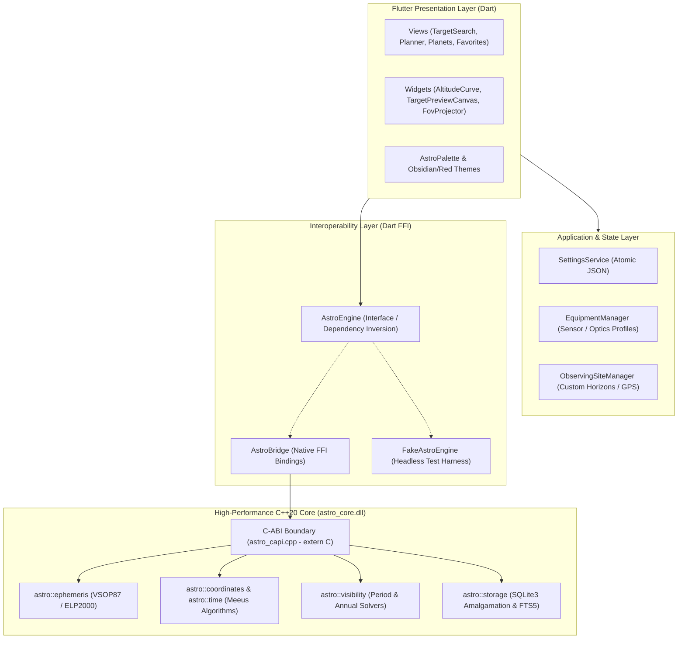

# MENELWAY — Astro Target & Session Planner

[](https://github.com/FMelloRodrigo/astro_targets_tool/actions/workflows/ci.yml)
[](LICENSE)
[](https://flutter.dev)

**MENELWAY** is a high-performance application for deep-sky astrophotography session planning, supporting desktop and mobile environments. It couples a fast C++ calculation core with a modern Flutter user interface, running offline with self-contained databases and ephemerides.

---

## Key Features

- **Comprehensive Object Catalogs**: Over 13,000 deep-sky objects (Messier, Caldwell, NGC, IC, Arp, Herschel 400), plus solar system planets and 80+ navigational/bright stars with real-time VSOP87/ELP2000 ephemeris calculations.
- **Deep-Sky & Night Filtering**: Real-time altitude curves, transit times, darkness intervals (civil, nautical, astronomical dusk/dawn), moon separation, and moon illumination calculation.
- **Yearly Observing Window**: Annual visibility solver computing rise/set curves across all 365 days, optimal observation windows, and peak observing dates.
- **Period Planner**: Search targets observable within future date intervals (e.g. upcoming 7 days, 14 days, next month) with Moon phase analysis.
- **Equipment Framing Simulator**: Focal length and sensor dimension framing simulator with FOV overlays, visual target dimensions, and interactive panning and zooming.
- **Observing Lists & Notes**: User-curated observing plans stored in a local SQLite database with SQLite FTS5 full-text search.
- **Telescope Red Night-Vision Mode**: Complete dark-adaptation red theme with high contrast and zero blinding UI elements via `AstroPalette`.
- **Bilingual Support**: Full internationalization for English and Portuguese (Brasil).
- **Responsive Layout**: Adaptive UI supporting desktop workstations and mobile screens in the field.

---

## Development Notes

Beyond building a tool that I truly needed, this was an opportunity to learn. I am an experienced game developer primarily working with Unreal Engine. While I write C++ daily, Unreal's C++ is a different beast from modern, standard C++. This project was a chance to dive into modern C++20, explore fundamental astronomical mathematics and algorithms, and pick up Flutter/Dart as a bonus.

Worked on this app in my free time, generative AI was heavily utilized to accelerate development, and I haven't had the time to meticulously study, review the entire codebase yet. As such, the code is by no means an reference for architecture. It is first and foremost a personal utility and learning playground of mine.

---

## Architecture

### System Topology



### Directory Structure

```
astro_targets_tool/
├── .github/workflows/          # Automated GitHub Actions CI workflow (C++, Python, Flutter)
├── core/                       # High-Performance C++20 Core & C-ABI
│   ├── include/astro/          # C++ headers (units, ephemeris, coordinates, time, storage)
│   ├── src/                    # C++ implementations (VSOP87, ELP2000, Meeus algorithms)
│   ├── capi/                   # Exception-guarded C-ABI exports (astro_capi.cpp / .h)
│   ├── data/                   # Catalogs SQLite database builder (build_catalogs.py)
│   └── tests/                  # C++ test suites (test_astro, test_storage, test_capi)
│
├── app/                        # Modern Flutter UI (Desktop & Mobile)
│   ├── lib/
│   │   ├── core/               # Dart FFI bindings & bridge (AstroEngine, AstroBridge)
│   │   ├── models/             # Domain models (TargetItem, FilterState, NightSummary)
│   │   ├── theme/              # AstroPalette token system (Obsidian Dark & Night-Vision Red)
│   │   ├── views/              # Master/detail responsive desktop and mobile views and dialogs
│   │   └── widgets/            # Custom painters (AltitudeCurveChart, TargetPreviewCanvas)
│   └── test/                   # 146+ comprehensive unit and widget tests
│
├── dist/                       # Packaged standalone Windows portable releases
├── scripts/data_tools/         # Python unit tests and catalog verification scripts
└── package_portable_release.ps1 # Production portable distribution packager
```

---

## Astronomy Approximations & Accuracy

Menelway is designed specifically for **session planning, telescope pointing, and astrophotography scheduling**. The calculation core employs analytical algorithms tailored for real-time responsiveness:

1. **J2000 Coordinate System**:
   - Deep-sky catalog coordinates (RA/Dec) are referenced to the **J2000.0 epoch**.
   - Stellar proper motion and precession are not applied on the fly, introducing a nominal angular offset of ~0.36° across 26 years. This is well within typical finder scope and telescope field-of-view tolerances for targeting.

2. **Geocentric Lunar Ephemeris**:
   - The Moon's position is computed using an analytical ELP2000 truncation from the Earth's center without topocentric parallax correction.
   - For an observer on Earth's surface, this introduces an angular position variation of up to ~1.0° relative to the background stars, which is sufficient for determining lunar phase, illumination percentage, and sky separation for deep-sky scheduling.

3. **Yearly & Period Visibility Sampling**:
   - The annual visibility solver computes altitude curves and twilight windows using local midnight sampling across 365 days.
   - For stars and deep-sky objects whose equatorial coordinates are stationary, this gives exact seasonal windows. Rapidly moving solar system bodies (e.g. inner planets, Moon) vary continuously throughout the night.

4. **Transit Times**:
   - The reported `transit_time` in session summaries represents the time of **maximum altitude within the active darkness window** rather than mathematical meridian transit, ensuring observers know the peak imaging window during available night hours.

5. **Analytical Truncations**:
   - Planetary ephemerides use truncated analytical VSOP87 series. Positions are accurate to within arcseconds of NASA JPL Horizons ephemerides over the 1900–2100 window, providing high calculation throughput for scanning thousands of candidates in milliseconds.

6. **Timezones and Daylight Saving**:
   - The annual solver calculates projections using a fixed observer UTC offset; regional daylight saving transitions are not dynamically applied across historical or future annual spans.

---

## Building from Source

### Prerequisites

- **Windows 10/11 x64**
- **Visual Studio 2022** with "Desktop development with C++" and MSBuild
- **CMake 3.20+**
- **Flutter SDK 3.x+** with Windows Desktop enabled (`flutter config --enable-windows-desktop`)
- **Python 3.10+** (for catalog build & verification tools)

### 1. Compile C++ Core Engine

```powershell
# Using CMake directly:
cmake -B core/build -S core -DCMAKE_BUILD_TYPE=Release
cmake --build core/build --config Release

# Or using MSBuild (from Developer Command Prompt / VS Developer PowerShell):
msbuild "core\build\astro_core.sln" /p:Configuration=Release /p:Platform=x64
```

### 2. Run Test Suites

#### C++ Native Tests & CTest
```powershell
# Run individual test executables:
.\core\build\Release\test_astro.exe
.\core\build\Release\test_storage.exe
.\core\build\Release\test_capi.exe

# Or execute CTest:
ctest --test-dir core/build --output-on-failure -C Release
```

#### Python Data Tools Tests
```powershell
python -m unittest scripts/data_tools/test_arp_parse.py
python -m unittest scripts/data_tools/test_catalogs_query.py
```

#### Flutter Static Analysis & Widget Tests
```powershell
cd app
flutter analyze
flutter test
cd ..
```

### 3. Build Flutter Windows Release

```powershell
cd app
flutter build windows --release --no-tree-shake-icons
cd ..
```

### 4. Package Standalone Portable Bundle

```powershell
powershell -ExecutionPolicy Bypass -File package_portable_release.ps1
```

The resulting distribution is packaged to `dist/menelway_astro_planner_win64_portable/` and zipped as `dist/menelway_astro_planner_win64_portable.zip`.

---

## License

MIT License. See [LICENSE](LICENSE) for details.
